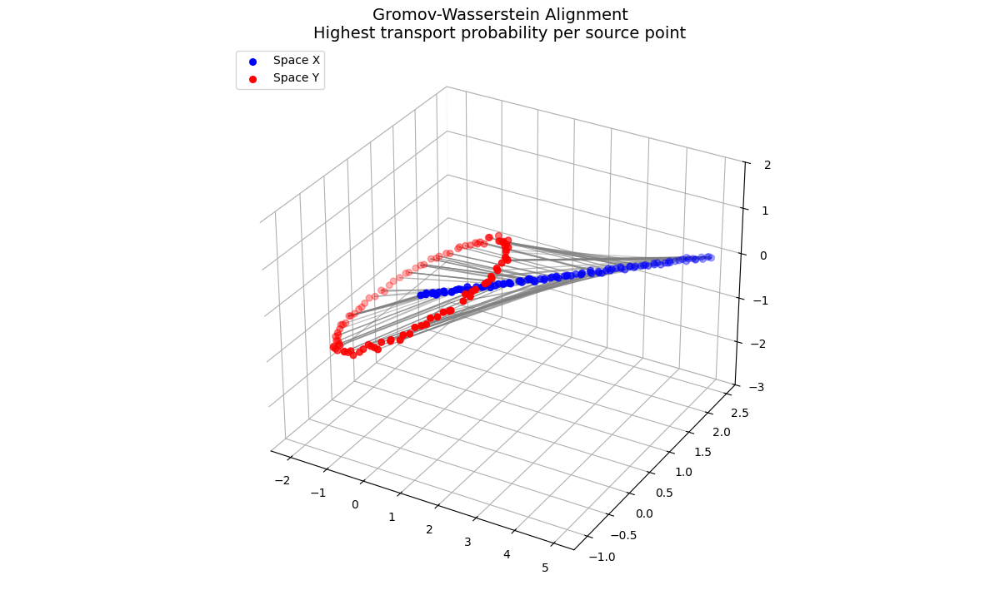
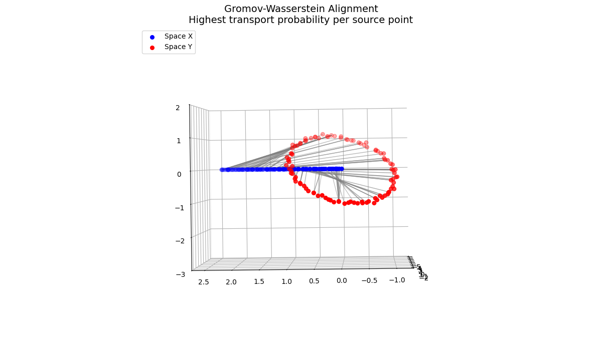

# Optimal Transport

## Motivation

Imagine you want to move a pile of sand from one location to another with the minimum possible effort. This intuitive idea is the foundation of Optimal Transport.

We define the key components of the transport space 
- \\(X\\) (Source Space): The space containing the initial mass supplies.
- \\(Y\\) (Target Space): The space containing the target demands.
- \\(\mu\\) (Source Distribution): A probability measure representing the distribution of mass across \\(X\\).
- \\(\nu\\) (Target Distribution): A probability measure representing the distribution of mass across \\(Y\\).

## Monge formulation

### Definition

We need to define the push-forward operator. Let \\(f: X \to Y\\) be a measurable function between two measurable spaces \\((X, \Sigma_X)\\) and \\((Y, \Sigma_Y)\\), and let \\(\mu: \Sigma_X \to [0,+\infty)\\) be a measure on \\(X\\). The pushforward of \\(\mu\\) by \\(f\\), denoted as \\(f_\\#\mu\\), is a measure \\(f_{\\#}\mu: \Sigma_Y \to [0,+\infty)\\) on \\(Y\\) given by

$$(f_{\#}\mu)(B)=\mu (f^{-1}(B)), \qquad B \in \Sigma_Y.$$


In 1781, French mathematician Gaspard Monge proposed looking for a deterministic mapping \\(T: X \to Y\\) that moves the entire mass from \\(X\\) to \\(Y\\). This mapping must satisfy the push-forward condition \\(T_\\#\mu = \nu\\), ensuring that the transported mass exactly matches the target distribution. The goal is to minimize the total transportation cost

$$\inf_{T} \int_X c(x, T(x)) d\mu(x)$$

where \\(c(x, y)\\) represents the cost of moving a unit of mass from point \\(x \in X\\) to point \\(y \in Y\\).

### Example

Let's look at a concrete 1D example. Suppose our source space is \\(X = [0, 1]\\), and our target space is \\(Y = [3, 4]\\). In the source space \\(X\\), the sand gets denser toward the right side with the probability density function

$$f(x) = 2x, \quad \forall x \in [0, 1].$$


In the target space \\(Y\\), the sand needs to be distributed with the density function

$$g(y) = 3(y - 3)^2, \quad \forall y \in [3, 4].$$


The cost function is chosen to be \\(c(x, y) = \vert{}x - y\vert{}\\), representing the linear distance between the source and the target location. For example, we consider the deterministic mapping \\(T(x) = 3 + x^{2/3}\\). Note that the Cumulative Distribution Functions of the source and the target are

$$F(x) = \int_0^x f(t) \, dt = \int_0^x 2t \, dt = x^2, \quad \forall x \in [0, 1],$$


$$G(y) = \int_3^y g(t) \, dt = \int_3^y 3(t - 3)^2 \, dt = (y - 3)^3, \quad \forall y \in [3, 4].$$


We have

$$G(T(x)) = (T(x) - 3)^3 = \left( (3 + x^{2/3}) - 3 \right)^3 = (x^{2/3})^3 = x^2 = F(x).$$

By definition of the push-forward operator, \\(T\\) satisfies the condition \\(T_\\#\mu = \nu\\), which means it is a valid mapping for the Monge problem. The total cost for this mapping is then

$$\begin{aligned}
\text{Total Cost} &= \int_0^1 \vert{}x - T(x)\vert{} \cdot f(x) \, dx \\
&= \int_0^1 \vert{}x - (3 + x^{2/3})\vert{} \cdot (2x) \, dx \\
&= \int_0^1 (3 + x^{2/3} - x) \cdot 2x \, dx \\
&= \int_0^1 (6x + 2x^{5/3} - 2x^2) \, dx = \dfrac{37}{12}.
\end{aligned}$$

### Closed-Form Solution for 1D case

For any cost \\(c(x,y) = h(x-y)\\), where \\(h: \mathbb{R} \to \mathbb{R}\\) is a **strictly convex** function, we first show that the optimal transport map \\(T\\) is a non-decreasing function. Assume \\(T\\) is decreasing. Thus, there exist \\(x_1 < x_2\\) such that \\(T(x_1) > T(x_2)\\). The cost for these points is 

$$C_{\text{original}} = h(x_1 - T(x_1)) + h(x_2 - T(x_2)).$$

We consider another mapping such that \\(x_1\\) is mapped to \\(T(x_2)\\) and \\(x_2\\) is mapped to \\(T(x_1)\\), the new cost is

$$C_{\text{new}} = h(x_1 - T(x_2)) + h(x_2 - T(x_1)).$$


The difference is 

$$C_{\text{new}} - C_{\text{original}} = h(x_{1}-T(x_{2})) + h(x_{2}-T(x_{1})) - h(x_{1}-T(x_{1})) - h(x_{2}-T(x_{2})).$$


Consider points \\(A = x_1 - T(x_1)\\), \\(B = x_1 - T(x_2)\\), \\(C = x_2 - T(x_1)\\), \\(D = x_2 - T(x_2)\\). Note that \\(x_1 < x_2\\) and \\(T(x_1) > T(x_2)\\), we have \\(A < B < D\\), \\(A < C < D\\). In other words, \\(B\\) and \\(C\\) are convex combinations of \\(A\\) and \\(D\\). Let \\(\lambda := \dfrac{x_2 - x_1}{(x_2 - x_1) + (T(x_1) - T(x_2))} \in (0, 1)\\). Thus, 

$$B = (1 - \lambda) D + \lambda A, \qquad C = \lambda D + (1 - \lambda) A.$$


Since \\(h\\) is strictly convex, we have

$$h(B) < (1 - \lambda) h(D) + \lambda h(A), \qquad h(C) < \lambda h(D) + (1 - \lambda) h(A).$$


It follows that 

$$h(B) + h(C) < h(A) + h(D).$$

This is equivalent to 

$$h(x_1 - T(x_2)) + h(x_2 - T(x_1)) < h(x_1 - T(x_1)) + h(x_2 - T(x_2)),$$

which means

$$C_{\text{new}} < C_{\text{original}}.$$


This contradicts the optimality of \\(T\\), which means our assumption is false. Therefore, for all \\(x_1 < x_2\\), we must have \\(T(x_1) \le T(x_2)\\), proving \\(T\\) is non-decreasing.


Given two measures \\(\mu\\) and \\(\nu\\) on \\(\mathbb{R}\\) with CDFs

$$F(x) = \mu((-\infty, x]), \qquad G(y) = \nu((-\infty, y]),$$

respectively. Since \\(T\\) is a non-decreasing function, the pre-image of \\((-\infty, T(x)]\\) under \\(T\\) is simply \\((-\infty, x]\\). That means \\(T^{-1}((-\infty, T(x)]) = (-\infty, x]\\). By the push-forward definition, for any measurable set \\(B\\), we have \\(\nu(B) = \mu(T^{-1}(B))\\). Applying this condition to the set \\((-\infty, T(x)]\\) gives

$$\nu((-\infty, T(x)]) = \mu(T^{-1}((-\infty, T(x)])) = \mu((-\infty, x]).$$


Substituting the CDFs, we obtain

$$G(T(x)) = F(x).$$


Remember that the generalized inverse of \\(G\\) is defined by

$$G^{-1}(u) = \inf\{y\in\mathbb{R}: G(y)\ge u\}, \qquad u\in[0,1].$$


Applying \\(G^{-1}\\) to both sides, we obtain the closed form solution to the problem

$$T(x) = G^{-1}(F(x)).$$


### Limitation

The mapping \\(T\\) forces each point \\(x\\) in the source space to send **all** of its mass to **only one** specific point \\(y\\) in the target space. Nevertheless, in reality, there are cases that a pile of sand should be split and distributed across multiple different target locations for efficiency. Because of this rigidity, Monge's problem can sometimes have no solution at all. This limitation led mathematicians like Leonid Kantorovich to relax the condition.

## Kantorovich formulation

### Definition

The limitation was solved in 1942 by the Soviet mathematician and economist Leonid Kantorovich, a breakthrough that later earned him the Nobel Prize in Economics. Instead of forcing a strict one-to-one mapping \\(T\\), Kantorovich allowed mass splitting. Consider a joint measure \\(\gamma(x, y)\\) defined over the product space \\(X \times Y\\), which represents the amount of mass that travels from a source location \\(x\\) to a target location \\(y\\). Trivially, this \\(\gamma\\) must satisfy two marginal conditions

$$\int_Y d\gamma(x, y) = d\mu(x), \qquad \int_X d\gamma(x, y) = d\nu(y).$$


The Kantorovich formulation for the general optimal transport problem therefore can be written as a linear program

$$\inf_{\gamma \in \Pi(\mu, \nu)} \int_{X \times Y} c(x, y) \, d\gamma(x, y),$$

where \\(\Pi(\mu, \nu)\\) is the set of all valid joint probability measures whose marginals are \\(\mu\\) and \\(\nu\\).

From this definition, let \\(T\\) be a transport map satisfying the Monge problem between \\(\mu\\) and \\(\nu\\), and define \\(\gamma_T = (id, T)_\\#\mu\\). Thus, \\(\gamma_T\\) is a transport plan between \\(\mu\\) and \\(\nu\\).

### Example

Let's look at a concrete example where Kantorovich differs from Monge by using mass splitting. Suppose our source space is \\(X = [0, 1]\\) and our target space is \\(Y = [0, 2]\\). In the source space \\(X\\), the sand has a uniform distribution with the probability density function

$$f(x) = 1, \quad \forall x \in [0, 1].$$


In the target space \\(Y\\), the sand needs to be distributed into two separate intervals with the density function
$$g(y) = 
\begin{cases} 
1, & \forall y \in \left[0, \dfrac12\right], \\[0.4cm] 
1, & \forall y \in \left[\dfrac32, 2\right], \\[0.3cm] 
0, & \text{otherwise}.
\end{cases}$$

The cost function is chosen to be \\(c(x, y) = \vert{}x - y\vert{}\\). We consider the transport plan \\(\gamma(x, y)\\) on \\(X \times Y\\) defined by

$$\gamma(x, y) = \dfrac{1}{2} \delta\left(y - \dfrac{x}{2}\right) + \dfrac{1}{2} \delta\left(y - \left(\dfrac{x}{2} + \dfrac{3}{2}\right)\right), \quad \forall x \in [0, 1],$$


where \\(\delta\\) is the Dirac function. Intuitively, this transport plan splits the mass at each point \\(x \in [0,1]\\) equally into two halves, one half is sent to \\(y=x/2\\) in the first target interval \\(\left[0, \dfrac12\right]\\), while the other half is sent to \\(y=\dfrac{x}2+\dfrac32\\) in the second target interval \\(\left[\dfrac32,2\right]\\). To verify that \\(\gamma\\) is a valid Kantorovich transport plan, we check its marginals. Integration with respect to \\(y\\) gives

$$\int_Y \gamma(x, y) \, dy = \dfrac{1}{2} + \dfrac{1}{2} = 1 = f(x).$$


Now we need to compute the integral over \\(X\\), which is

$$\int_X \gamma(x, y) \, dx = \int_0^1 \left[ \dfrac{1}{2} \delta\left(y - \dfrac{x}{2}\right) + \dfrac{1}{2} \delta\left(y - \left(\dfrac{x}{2} + \dfrac{3}{2}\right)\right) \right] dx.$$


For \\(y \in \left[0, \dfrac12\right]\\), only the first term contributes, which means 

$$\int_X \gamma(x, y) \, dx = \int_0^1 \dfrac{1}{2} \delta\left(y - \dfrac{x}{2}\right) dx = \int_0^{1/2} \dfrac{1}{2} \delta(y-u) \cdot 2 \, du = \int_0^{1/2} \delta(y-u) \, du = 1.$$


For \\(y \in \left[\dfrac32,2\right]\\), only the second term contributes. Similarly, we have 

$$\int_X \gamma(x, y) \, dx = \int_0^1 \dfrac{1}{2} \delta\left(y - \left(\dfrac{x}{2} + \dfrac{3}{2}\right)\right) dx = 1.$$


For any other \\(y\\), the integral is \\(0\\). Combining these results, we have 
$$\int_X \gamma(x, y) \, dx = g(y).$$


Therefore, \\(\gamma(x, y)\\) is a valid Kantorovich transport plan. The total cost for this Kantorovich plan is then

$$\begin{aligned} 
\text{Total Cost} &= \int_{X \times Y} \vert{}x - y\vert{} \, d\gamma(x, y) \\
&= \int_0^1 \left[ \dfrac{1}{2} \left\vert{}x - \dfrac{x}{2}\right\vert{} + \dfrac{1}{2} \left\vert{}x - \left(\dfrac{x}{2} + \dfrac{3}{2}\right)\right\vert{} \right] \cdot f(x) \, dx \\
&= \int_0^1 \dfrac{3}{4} \, dx = \dfrac{3}{4}. 
\end{aligned}
$$

### Dual problem

The Primal problem is to minimize the total cost

$$\inf_{\gamma \ge 0} \int_{X \times Y} c(x, y) \, d\gamma(x, y)$$

subject to the two marginal constraints

$$\int_Y d\gamma(x, y) = d\mu(x), \qquad \int_X d\gamma(x, y) = d\nu(y).$$


We use the Lagrange multipliers to change this Primal problem into a Dual problem. Since there is a constraint for every point \\(x \in X\\) and every point \\(y \in Y\\), using a single number for each constraint is impossible due to the infinite number of points. Therefore, our multipliers must be functions. Let \\(\varphi(x)\\) be the multiplier for the source constraint, and \\(\psi(y)\\) be the multiplier for the target constraint. The Lagrangian function is then

$$\mathcal{L}(\gamma, \varphi, \psi) = \int_{X \times Y} c(x, y) \, d\gamma(x, y) - \int_X \varphi(x) \left( \int_Y d\gamma(x, y) - d\mu(x) \right) - \int_Y \psi(y) \left( \int_X d\gamma(x, y) - d\nu(y) \right).$$


Rearranging the terms, we obtain

$$\mathcal{L}(\gamma, \varphi, \psi) = \int_X \varphi(x) \, d\mu(x) + \int_Y \psi(y) \, d\nu(y) + \int_{X \times Y} \left( c(x, y) - \varphi(x) - \psi(y) \right) \, d\gamma(x, y).$$


By definition, the Dual problem is written as

$$\sup_{\varphi, \psi} \inf_{\gamma \ge 0} \mathcal{L}(\gamma, \varphi, \psi).$$


We now consider the infimum term 
$$M := \inf_{\gamma \ge 0} \int_{X \times Y} \left( c(x, y) - \varphi(x) - \psi(y) \right) \, d\gamma(x, y)$$
 in the problem. Since \\(\gamma\\) is non-negative, if there exists a specific pair \\((x_0,y_0)\\) such that \\(c(x_0, y_0) - \varphi(x_0) - \psi(y_0) < 0\\), we could assign an infinitely large mass \\(\gamma(x_0, y_0) \to +\infty\\) to imply \\(M \to -\infty\\). Because the Dual problem wants to find the supremum, getting \\(-\infty\\) is the worst possible outcome. Therefore, to prevent this, the dual variables \\(\varphi\\) and \\(\psi\\) must satisfy 

$$\varphi(x) + \psi(y) \le c(x, y), \quad \forall (x, y) \in X \times Y.$$


When this condition is satisfied, \\(M\\) is \\(0\\) (achieved by setting \\(\gamma = 0\\)). This yields the final Dual problem

$$\begin{array}{ll}
     \displaystyle \sup_{\varphi, \psi} & \displaystyle \int_X \varphi(x) \, d\mu(x) + \int_Y \psi(y) \, d\nu(y),  \\[0.4cm]
     \text{s.t} & \varphi(x) + \psi(y) \le c(x, y), \quad \forall (x, y) \in X \times Y.
\end{array}$$


We now prove a fundamental property of duality, which is the Weak Duality. Let \\(\gamma \in \Pi(\mu, \nu)\\) be any valid transport plan for the Primal problem, and let \\((\varphi, \psi)\\) be any valid pair of functions for the Dual problem. Since \\(\gamma(x, y)\\) is a non-negative probability measure, we can integrate both sides of the constraint \\(\varphi(x) + \psi(y) \le c(x, y)\\) with respect to \\(d\gamma(x, y)\\) to obtain 

$$\int_{X \times Y} (\varphi(x) + \psi(y)) \, d\gamma(x, y) \le \int_{X \times Y} c(x, y) \, d\gamma(x, y).$$


This is equivalent to 

$$\int_{X \times Y} \varphi(x) \, d\gamma(x, y) + \int_{X \times Y} \psi(y) \, d\gamma(x, y) \le \int_{X \times Y} c(x, y) \, d\gamma(x, y).$$


Note that \\(\displaystyle \int_Y d\gamma(x, y) = d\mu(x)\\), \\(\displaystyle \int_X d\gamma(x, y) = d\nu(y)\\), \\(\varphi(x)\\) only depends on \\(x\\), and \\(\psi(y)\\) only depends on \\(y\\), the inequality can be rewritten as 

$$\int_X \varphi(x) \, d\mu(x) + \int_Y \psi(y) \, d\nu(y) \le \int_{X \times Y} c(x, y) \, d\gamma(x, y).$$


Since this inequality holds for any valid \\(\gamma\\) and any valid \\((\varphi, \psi)\\), we must have

$$\sup_{\varphi, \psi} \left( \int_X \varphi \, d\mu + \int_Y \psi \, d\nu \right) \le \inf_{\gamma \in \Pi(\mu, \nu)} \int_{X \times Y} c(x, y) \, d\gamma.$$


This is the Weak Duality.

### Algorithm to solve

When dealing with large datasets, the computational complexity of solving the linear problem under Kantorovich formulation is \\(\mathcal{O}(N^3 \log N)\\), making it too slow for practical use in high-dimensional settings or deep learning pipelines. To break this computational bottleneck, mathematician Marco Cuturi introduced a brilliant twist by adding an entropy regularization term to the objective function. The optimal transport problem under entropy regularization is of the form

$$\begin{array}{ll}
     \displaystyle \min_{\gamma} & \displaystyle \sum_{i,j} C_{i,j} \gamma_{i,j} + \epsilon \sum_{i,j} \gamma_{i,j} (\log \gamma_{i,j} - 1), \\
     \text{s.t} & \displaystyle \sum_j \gamma_{i,j} = P_i, \quad \displaystyle \sum_i \gamma_{i,j} = Q_j,
\end{array}$$

where \\(P\\) and \\(Q\\) are the source and target probability distributions, respectively, \\(\gamma_{i,j}\\) is the transport plan, \\(C_{i,j}\\) is the transportation cost between source point \\(i\\) and target point \\(j\\), and \\(\epsilon>0\\) is the entropy regularization parameter. The term \\(\displaystyle \sum C_{i,j} \gamma_{i,j}\\) is a linear function of \\(\gamma_{i,j}\\). Thus, it is also convex. Consider the function \\(h(x) = x(\log x - 1)\\) for \\(x > 0\\). The derivatives are 

$$h'(x) = 1 \cdot (\log x - 1) + x \cdot \left(\dfrac{1}{x}\right) = \log x - 1 + 1 = \log x,$$


$$h''(x) = \dfrac{1}{x} > 0, \quad \forall x > 0.$$


Hence, the term \\(\displaystyle \epsilon \sum_{i,j} \gamma_{i,j} (\log \gamma_{i,j} - 1)\\) is a strictly convex function. Therefore, the objective function is strictly convex over the entire matrix \\(\gamma\\). The constraints of the problem are linear constraints, which define a convex set. Consequently, the problem is classified as a strictly convex optimization problem, which attains a unique minimizer. The Lagrangian function is

$$\mathcal{L}(\gamma, f, g) = \sum_{i,j} C_{i,j} \gamma_{i,j} + \epsilon \sum_{i,j} \gamma_{i,j} (\log \gamma_{i,j} - 1) + \sum_i f_i \left( \sum_j \gamma_{i,j} - P_i \right) + \sum_j g_j \left( \sum_i \gamma_{i,j} - Q_j \right),$$

where \\(f_i\\) and \\(g_j\\) are the Lagrangian multipliers. To find the minimum, we take the partial derivative with respect to each element \\(\gamma_{i,j}\\) and set it to zero,

$$\dfrac{\partial \mathcal{L}}{\partial \gamma_{i,j}} = C_{i,j} + \epsilon \log \gamma_{i,j} + f_i + g_j = 0.$$


It follows that

$$\gamma_{i,j}(f,g) = \exp\left(-\dfrac{1}{\epsilon} f_i\right) \, \exp\left(-\dfrac{1}{\epsilon} C_{i,j}\right) \, \exp\left(-\dfrac{1}{\epsilon} g_j\right).$$


Substituting this expression back into the Lagrangian \\(\mathcal{L}(\gamma, f, g)\\) gives the dual maximization problem \\(\max_{f, g} \mathcal{D}(f, g)\\), where

$$\mathcal{D}(f, g) = -\sum_{i=1}^n f_i P_i - \sum_{j=1}^m g_j Q_j - \epsilon \sum_{i,j} \exp\left(-\dfrac{1}{\epsilon} f_i\right) \, \exp\left(-\dfrac{1}{\epsilon} C_{i,j}\right) \, \exp\left(-\dfrac{1}{\epsilon} g_j\right).$$


Equivalently, this can be rewritten as a minimization problem

$$\min_{f \in \mathbb{R}^n, \, g \in \mathbb{R}^m} \; \Phi(f, g) := \sum_{i=1}^n f_i P_i + \sum_{j=1}^m g_j Q_j + \epsilon \sum_{i,j} \exp\left(-\dfrac{1}{\epsilon} f_i\right) \, \exp\left(-\dfrac{1}{\epsilon} C_{i,j}\right) \, \exp\left(-\dfrac{1}{\epsilon} g_j\right).$$


Because the exponential function is strictly convex and the linear function is convex, the objective \\(\Phi(f, g)\\) is strictly convex with respect to each block of variables \\(f\\) and \\(g\\) individually. We can therefore minimize \\(\Phi(f, g)\\) using Exact Block Coordinate Descent.
In particular, it minimizes over \\(f\\) when \\(g\\) is fixed and then minimizes over \\(g\\) when \\(f\\) is fixed. To update \\(f\\) with \\(g^{(t)}\\) fixed, we solve \\(f^{(t+1)} = \arg\min_f \Phi(f, g^{(t)})\\) by setting the gradient with respect to \\(f_i\\) to zero,

$$\dfrac{\partial \Phi}{\partial f_i} = P_i - \sum_j \exp\left(-\dfrac{1}{\epsilon} f_i\right) \, \exp\left(-\dfrac{1}{\epsilon} C_{i,j}\right) \, \exp\left(-\dfrac{1}{\epsilon} g_j^{(t)}\right) = 0.$$


Denote \\(u_i := \exp\left(-\dfrac{1}{\epsilon} f_i\right)\\), \\(v_j := \exp\left(-\dfrac{1}{\epsilon} g_j\right)\\), and \\(K_{i,j} = \exp\left(-\dfrac{1}{\epsilon} C_{i,j}\right)\\). This implies \\(P_i - u_i^{(t+1)} \sum_j K_{i,j} v_j^{(t)} = 0\\), which means 

$$u^{(t+1)} = \dfrac{P}{K v^{(t)}}.$$


Similarly, to update \\(g\\) with \\(f^{(t+1)}\\) fixed, we solve \\(g^{(t+1)} = \arg\min_g \Phi(f^{(t+1)}, g)\\) to obtain

$$v^{(t+1)} = \dfrac{Q}{K^\top u^{(t+1)}}.$$


Thus, the dual objective decreases monotonically,

$$\Phi\left(f^{(0)}, g^{(0)}\right) \ge \Phi\left(f^{(1)}, g^{(0)}\right) \ge \Phi\left(f^{(1)}, g^{(1)}\right) \ge \dots.$$


Since the primal problem is strictly convex and strictly feasible (for example \\(\gamma_{i,j} = P_i Q_j > 0\\)), Strong Duality holds. This also guarantees that \\(\Phi(f, g)\\) is bounded below by the finite optimal value. A monotonically decreasing sequence that is bounded below must converge. Consequently, the iteration 

$$u^{(t+1)} = \dfrac{P}{K v^{(t)}}, \qquad v^{(t+1)} = \dfrac{Q}{K^\top u^{(t+1)}}$$

converges to the optimal solution of the entropy-regularized optimal transport problem. Moreover, since the optimal solution satisfies \\(\gamma_{i,j} = \exp\left(-\dfrac{1}{\epsilon} f_i\right) \, \exp\left(-\dfrac{1}{\epsilon} C_{i,j}\right) \, \exp\left(-\dfrac{1}{\epsilon} g_j\right)\\), we can recover the optimal transport plan as

$$\gamma^{(t)} = \text{diag}(u^{(t)}) \, K \, \text{diag}(v^{(t)}).$$


The algorithm behind this is the classic **Sinkhorn-Knopp algorithm**, originally developed by Richard Sinkhorn and Paul Knopp way back in 1967. In 2013, by adding an entropy regularization term to the Optimal Transport objective, Marco Cuturi brought Sinkhorn-Knopp straight into OT!


## Implementation 

Building on the formulation discussed above, here is how we implement the Sinkhorn-Knopp algorithm in code.

```python
def sinkhorn_knopp(P, Q, C, epsilon, max_iters=1000, tol=1e-5):
    K = np.exp(-C / epsilon)
    u = np.ones_like(P)
    v = np.ones_like(Q)
    
    for _ in range(max_iters):
        u = P / (K @ v + 1e-12)
        v_new = Q / (K.T @ u + 1e-12)
        
        if np.max(np.abs(v_new - v)) < tol:
            v = v_new
            break
        v = v_new
        
    gamma = u[:, None] * K * v[None, :]
    return gamma
```

#### Color Transfer in Images

In image processing, there is a task called color transfer, which applies the exact mood, lighting, and color palette of a reference image to our own photo. OT solves this by treating the pixel color distributions of both images as probability measures. 


<details><summary markdown="span">Code</summary>

```python
import numpy as np
import matplotlib.pyplot as plt
from skimage.transform import resize
from scipy.spatial.distance import cdist

def sinkhorn_knopp(P, Q, C, epsilon, max_iters=1000, tol=1e-5):
    K = np.exp(-C / epsilon)
    u = np.ones_like(P)
    v = np.ones_like(Q)
    
    for _ in range(max_iters):
        u = P / (K @ v + 1e-12)
        v_new = Q / (K.T @ u + 1e-12)
        
        if np.max(np.abs(v_new - v)) < tol:
            v = v_new
            break
        v = v_new
        
    gamma = u[:, None] * K * v[None, :]
    return gamma

def compute_transport_plan(source_img, target_img, epsilon=0.05):
    if source_img.shape[2] == 4:
        source_img = source_img[:, :, :3]
    if target_img.shape[2] == 4:
        target_img = target_img[:, :, :3]
        
    Xs = source_img.reshape(-1, 3).astype(float) / 255.0
    Xt = target_img.reshape(-1, 3).astype(float) / 255.0
    
    C = cdist(Xs, Xt, metric='sqeuclidean')
    P = np.ones(len(Xs)) / len(Xs)
    Q = np.ones(len(Xt)) / len(Xt)
    
    gamma = sinkhorn_knopp(P, Q, C, epsilon=epsilon, max_iters=1000)
    return Xs, Xt, gamma


def reconstruct_image(source_img, Xs, Xt, gamma):
    mapped_colors = gamma @ Xt
    
    N = len(Xs)
    mapped_colors = mapped_colors * N
    
    mapped_colors = np.clip(mapped_colors, 0.0, 1.0)
    
    h, w = source_img.shape[:2]
    result_img = mapped_colors.reshape((h, w, 3))
    
    return result_img


source_img = plt.imread('source.jpg')
target_img = plt.imread('target.jpg')
source_img = resize(source_img, (75, 75), anti_aliasing=True)
target_img = resize(target_img, (75, 75), anti_aliasing=True)
if source_img.max() <= 1.0:
    source_img = (source_img * 255).astype(np.uint8)
if target_img.max() <= 1.0:
    target_img = (target_img * 255).astype(np.uint8)

Xs, Xt, gamma = compute_transport_plan(source_img, target_img, epsilon=0.01)
result_img = reconstruct_image(source_img, Xs, Xt, gamma)

src_norm = source_img.astype(float) / 255.0
tgt_norm = target_img.astype(float) / 255.0

fig, axes = plt.subplots(1, 3, figsize=(15, 5))
axes[0].imshow(src_norm)
axes[0].set_title("Source Image")
axes[0].axis('off')

axes[1].imshow(tgt_norm)
axes[1].set_title("Target Image")
axes[1].axis('off')

axes[2].imshow(result_img)
axes[2].set_title("Color Transfer Result")
axes[2].axis('off')
plt.tight_layout()
plt.savefig("color_transfer_result.png", dpi=300, bbox_inches="tight")
```

</details>


#### Aligning Latent Embeddings

In natural language processing and cross-modal learning, different models often learn representations in completely different vector spaces. While comparing or translating between these spaces involves a wide range of sub-tasks, this work focuses specifically on mapping embeddings from one language to another using paired data. The goal is to learn a transformation matrix \\(W\\) that maps the source embedding (e.g., of "chien") as closely as possible to its target counterpart (e.g., "dog"). Instead of just optimizing point-by-point, Optimal Transport acts as an advanced, geometry-aware loss function. It leverages these known pairs as fixed anchors to ensure that the entire structural layout of the source vector space matches the target space seamlessly.

*Click [here](https://www.kaggle.com/code/nguyenthaitan/ot-embeddings) to see the implementation and result!*


## Gromov-Wasserstein formulation

### Definition

In the Kantorovich formulation, we require the source space \\(X\\) and the target space \\(Y\\) to belong to the same metric space. But what happens if \\(X\\) and \\(Y\\) exist in different spaces? This is where the **Gromov-Wasserstein (GW)** formulation comes in. Instead of trying to compare \\(x \in X\\) and \\(y \in Y\\) directly, GW compares the internal structures of each space. The core intuition is that if the distance between two points \\(x, x' \in X\\) is similar to the distance between two points \\(y, y' \in Y\\), then they should be mapped to each other.

Let \\((X, d_X)\\) and \\((Y, d_Y)\\) be two metric spaces equipped with probability measures \\(\mu\\) and \\(\nu\\), respectively. The Gromov-Wasserstein problem seeks a transport plan \\(\gamma \in \Pi(\mu, \nu)\\) that minimizes the discrepancy between these internal distances

$$\inf _{\gamma \in \Pi (\mu ,\nu )}\left(\int _{X\times Y}\int _{X\times Y}|{}d_{X}(x,x^{\prime })-d_{Y}(y,y^{\prime })|{}^{p} \, d\gamma (x,y) \, d\gamma (x^{\prime },y^{\prime })\right)^{1/p}.$$

The most common choice is \\(p=2\\), which relates to the Euclidean distance. Unlike the Monge or Kantorovich problems which optimize a linear function, the Gromov-Wasserstein objective involves the product of \\(\gamma_{x,y}\\) and \\(\gamma_{x\prime,y\prime}\\). Thus, this is considered as a **Quadratic Assignment Problem (QAP)**. 

### Algorithm to solve

To solve this QAP, we can apply the same *entropy regularization* used in Kantorovich formulation. By adding an entropy regularization term \\(\displaystyle H(\gamma) = \sum_{i,j} \gamma_{ij}(\log \gamma_{ij} - 1)\\), the GW problem is written as

$$\min_{\gamma \in \Pi(\mu, \nu)} \quad \sum_{i,j,k,\ell} \left(d_X(i,k) - d_Y(j,\ell)\right)^2 \gamma_{ij} \gamma_{k\ell} + \epsilon \sum_{i,j} \gamma_{ij}(\log \gamma_{ij} - 1),$$

where \\(\epsilon > 0\\) is the regularization parameter. However, although the entropy term \\(\epsilon H(\gamma)\\) is strictly convex, the objective still involves multiplying \\(\gamma_{ij}\\) and \\(\gamma_{k\ell}\\), meaning that its Hessian matrix is not guaranteed to be positive definite. Consequently, the problem is non-convex, we cannot guarantee finding a global optimal point, but rather only convergence to a local optimum.


Even though the global problem is non-convex, entropy regularization allows us to apply a Majorization-Minimization (MM) algorithm. The core idea is to turn the local subproblem into a strictly convex one. At iteration \\(t\\), we freeze our current transport plan \\(\gamma^{(t)}\\) and approximate the quadratic cost with a linear one by taking its first-order Taylor expansion. Specifically, denote

$$E(\gamma) := \sum_{i,j,k,\ell} \left(d_X(i,k) - d_Y(j,\ell)\right)^2 \gamma_{ij} \gamma_{k\ell},$$
 
the temporary problem is

$$\min_{\gamma \in \Pi(\mu, \nu)} \quad E(\gamma^{(t)}) + \langle \nabla E(\gamma^{(t)}), \gamma - \gamma^{(t)} \rangle + \epsilon H(\gamma).$$

Moreover, note that \\(E(\gamma^{(t)}) - \langle \nabla E(\gamma^{(t)}), \gamma^{(t)} \rangle\\) is a constant, we only need to solve 

$$\min_{\gamma \in \Pi(\mu, \nu)} \quad \langle \nabla E(\gamma^{(t)}), \gamma \rangle + \epsilon H(\gamma),$$

which is exactly the same as the Kantorovich formulation with entropy regularization. To solve this strictly convex subproblem, we can apply Sinkhorn-Knopp algorithm to find the new transport plan \\(\gamma^{(t+1)}\\). Then, we iteratively repeat this process - linearizing the objective and solving the resulting subproblem - until convergence.

The remaining question is to understand why this loop is guaranteed to converge. Denote the objective function of this GW problem by \\(\mathcal{F}(\gamma)\\). At each iteration \\(t\\), we construct a temporary, strictly convex function \\(\mathcal{Q}(\gamma \vert{} \gamma^{(t)})\\) such that it exactly equals the true objective at the current point, and sits entirely above or equal to the true objective everywhere else in the domain, which means

$$\mathcal{Q}(\gamma^{(t)} \vert{} \gamma^{(t)}) = \mathcal{F}(\gamma^{(t)}), \qquad \mathcal{Q}(\gamma \vert{} \gamma^{(t)}) \ge \mathcal{F}(\gamma).$$
 

Note that we have chosen \\(\mathcal{Q}(\gamma \vert{} \gamma^{(t)})\\) as

$$\mathcal{Q}(\gamma \vert{} \gamma^{(t)}) = E(\gamma^{(t)}) + \langle \nabla E(\gamma^{(t)}), \gamma - \gamma^{(t)} \rangle + \epsilon H(\gamma),$$

which combines the first-order Taylor expansion of \\(E(\gamma)\\) with the strictly convex entropy term. Actually, \\(E(\gamma)\\) is not a concave function, but by algebraically shifting the distance matrices, \\(E(\gamma)\\) can be transformed into a concave function. This shifting process does not change the final solution of the OT problem, because the row and column sums of any valid transport plan are strictly fixed by the marginal constraints \\(\mu\\) and \\(\nu\\). Any constant added to the distance matrices simply factors out as a constant shift in the objective function, leaving the optimal transport plan unchanged. Therefore, the first-order Taylor expansion term \\(E(\gamma^{(t)}) + \langle \nabla E(\gamma^{(t)}), \gamma - \gamma^{(t)} \rangle\\) ensures the second condition \\(\mathcal{Q}(\gamma \vert{} \gamma^{(t)}) \ge \mathcal{F}(\gamma)\\) holds. The first condition \\(\mathcal{Q}(\gamma^{(t)} \vert{} \gamma^{(t)}) = \mathcal{F}(\gamma^{(t)})\\) holds trivially. 

Once we have the strictly convex function \\(\mathcal{Q}\\), we find its unique global minimum using the Sinkhorn-Knopp algorithm. Denote this new minimizer as 

$$\gamma^{(t+1)} = \arg\min_{\gamma} \mathcal{Q}(\gamma \vert{} \gamma^{(t)}).$$


Because \\(\gamma^{(t+1)}\\) is the minimum of \\(\mathcal{Q}\\), we have

$$\mathcal{Q}(\gamma^{(t+1)} \vert{} \gamma^{(t)}) \le \mathcal{Q}(\gamma^{(t)} \vert{} \gamma^{(t)}).$$


Combining everything, we have 

$$\mathcal{F}(\gamma^{(t+1)}) \le \mathcal{Q}(\gamma^{(t+1)} \vert{} \gamma^{(t)}) \le \mathcal{Q}(\gamma^{(t)} \vert{} \gamma^{(t)}) = \mathcal{F}(\gamma^{(t)}).$$


This proves the decreasing monotonicity of \\(\mathcal{F}(\gamma)\\). Note that it is also bounded below, since it is a sum of squared distances. Therefore, the objective is guaranteed to converge. 


### Implementation 

For easier implementation, we first simplify the term 

$$\nabla E(\gamma) = \nabla \left( \sum_{i,j,k,\ell} \left(d_X(i,k) - d_Y(j,\ell)\right)^2 \gamma_{ij} \gamma_{k\ell} \right).$$
 

We have

$$\dfrac{\partial E(\gamma)}{\partial \gamma_{ij}} = \sum_{k,\ell} \left(d_X(i,k) - d_Y(j,\ell)\right)^2 \gamma_{k\ell} + \sum_{k,\ell} \left(d_X(k,i) - d_Y(\ell,j)\right)^2 \gamma_{k\ell}.$$


Note that \\(d_X\\) and \\(d_Y\\) are symmetric, which implies

$$\left(d_X(i,k) - d_Y(j,\ell)\right)^2 = \left(d_X(k,i) - d_Y(\ell,j)\right)^2.$$


Thus, 

$$\dfrac{\partial E(\gamma)}{\partial \gamma_{ij}} = 2 \sum_{k,\ell} \left(d_X(i,k) - d_Y(j,\ell)\right)^2 \gamma_{k\ell}.$$


Therefore, we can compute the simpler expression for \\(\nabla E(\gamma^{(t)})\\) as

$$\begin{aligned}
\left[\nabla E(\gamma^{(t)})\right]_{ij} &= 2 \sum_{k,\ell} \left(d_X(i,k) - d_Y(j,\ell)\right)^2 \gamma^{(t)}_{k\ell} \\
&= 2\left[ \sum_{k,\ell} d_X(i,k)^2 \gamma_{k\ell}^{(t)} + \sum_{k,\ell} d_Y(j,\ell)^2 \gamma_{k\ell}^{(t)} - 2\sum_{k,\ell} d_X(i,k) d_Y(j,\ell) \gamma_{k\ell}^{(t)} \right]\\
&= 2\left[ \sum_k d_X(i,k)^2 \left( \sum_\ell \gamma_{k\ell}^{(t)} \right) + \sum_\ell d_Y(j,\ell)^2 \left( \sum_k \gamma_{k\ell}^{(t)} \right) - 2\sum_{k,\ell} d_X(i,k) d_Y(j,\ell) \gamma_{k\ell}^{(t)} \right] \\
&= 2\left[ \sum_k d_X(i,k)^2 \mu_k + \sum_\ell d_Y(j,\ell)^2 \nu_\ell - 2 \sum_{k,\ell} d_X(i,k) d_Y(j,\ell) \gamma_{k\ell}^{(t)} \right].
\end{aligned}$$


Building on the formulation discussed, here is how we implement the algorithm in code.

```python
def gw_sinkhorn_knopp(X, Y, epsilon=1e-2, max_iter_mm=50, max_iter_sinkhorn=100):
    n, m = X.shape[0], Y.shape[0]
    
    Dx = cdist(X, X, metric='euclidean')
    Dy = cdist(Y, Y, metric='euclidean')
    
    Dx /= Dx.max()
    Dy /= Dy.max()
    
    mu = np.ones(n) / n
    nu = np.ones(m) / m

    # nabla E_{ij} = 2 ( sum_k d_X(i,k)^2 mu_k + sum_l d_Y(j,l)^2 nu_l - 2 sum_{k,l} d_X(i,k) d_Y(j,l) gamma_kl )
    const_X = np.dot(Dx**2, mu).reshape(-1, 1)
    const_Y = np.dot(Dy**2, nu).reshape(1, -1)
    const_C = const_X + const_Y
    
    gamma = np.outer(mu, nu)
    
    # Majorization-Minimization (MM)
    for t in range(max_iter_mm):
        # Linearization
        L = 2 * (const_C - 2 * np.dot(Dx, np.dot(gamma, Dy.T)))
        
        # Sinkhorn-Knopp
        K = np.exp(-L / epsilon)
        u = np.ones(n) / n
        
        for _ in range(max_iter_sinkhorn):
            v = nu / (np.dot(K.T, u) + 1e-12)
            u = mu / (np.dot(K, v) + 1e-12)
            
        gamma = u[:, None] * K * v[None, :]
        
    return gamma
```

#### 2D to 3D points

Aligning a 2D photograph of an object with its corresponding 3D model is a classic challenge for Gromov OT. While real-world applications often involve complex 2D images and 3D point clouds, we illustrate the core concept here using a simplified example of discrete point sets in 2D and 3D spaces.

<details><summary markdown="span">Code</summary>

```python
import numpy as np
from scipy.spatial.distance import cdist
import matplotlib.pyplot as plt

def generate_toy_data(n_points=100):
    # X is segment in 2D, Y is ellipse in 3D
    np.random.seed(42)
    
    t = np.linspace(0, 5, n_points)
    X = np.column_stack([t, 0.5 * t])
    X += np.random.normal(0, 0.03, X.shape)

    theta = np.linspace(0, 2 * np.pi, n_points, endpoint=False)
    a, b = 2.0, 1.0 
    
    y_x = a * np.cos(theta)
    y_y = b * np.sin(theta)
    y_z = 0.5 * y_x + 0.3 * y_y 
    
    Y = np.column_stack([y_x, y_y, y_z])
    Y += np.random.normal(0, 0.03, Y.shape)

    return X, Y

def gw_sinkhorn_knopp(X, Y, epsilon=1e-2, max_iter_mm=50, max_iter_sinkhorn=100):
    n, m = X.shape[0], Y.shape[0]
    
    Dx = cdist(X, X, metric='euclidean')
    Dy = cdist(Y, Y, metric='euclidean')
    
    Dx /= Dx.max()
    Dy /= Dy.max()
    
    mu = np.ones(n) / n
    nu = np.ones(m) / m

    # nabla E_{ij} = 2 ( sum_k d_X(i,k)^2 mu_k + sum_l d_Y(j,l)^2 nu_l - 2 sum_{k,l} d_X(i,k) d_Y(j,l) gamma_kl )
    const_X = np.dot(Dx**2, mu).reshape(-1, 1)
    const_Y = np.dot(Dy**2, nu).reshape(1, -1)
    const_C = const_X + const_Y
    
    gamma = np.outer(mu, nu)
    
    # Majorization-Minimization (MM)
    for t in range(max_iter_mm):
        # Linearization
        L = 2 * (const_C - 2 * np.dot(Dx, np.dot(gamma, Dy.T)))
        
        # Sinkhorn-Knopp
        K = np.exp(-L / epsilon)
        u = np.ones(n) / n
        
        for _ in range(max_iter_sinkhorn):
            v = nu / np.dot(K.T, u)
            u = mu / np.dot(K, v)
            
        gamma = u[:, None] * K * v[None, :]
        
    return gamma


X, Y = generate_toy_data(n_points=100)
optimal_plan = gw_sinkhorn_knopp(X, Y, epsilon=0.01)


def plot_gw_alignment(X, Y, gamma):
    fig = plt.figure(figsize=(12, 8))
    ax = fig.add_subplot(111, projection='3d')
    
    X_3d = np.column_stack((X, np.full(X.shape[0], 0)))
    
    ax.scatter(X_3d[:, 0], X_3d[:, 1], X_3d[:, 2], c='blue', label='Space X', s=30, depthshade=True)
    ax.scatter(Y[:, 0], Y[:, 1], Y[:, 2], c='red', label='Space Y', s=30, depthshade=True)

    max_gamma = np.max(gamma)
    for i in range(X.shape[0]):
        j_max = np.argmax(gamma[i, :])
        
        x_coords = [X_3d[i, 0], Y[j_max, 0]]
        y_coords = [X_3d[i, 1], Y[j_max, 1]]
        z_coords = [X_3d[i, 2], Y[j_max, 2]]
        
        alpha_val = min(1.0, gamma[i, j_max] / max_gamma)
        ax.plot(x_coords, y_coords, z_coords, c='gray', alpha=alpha_val, linewidth=1.0)
                
    ax.set_title(f"Gromov-Wasserstein Alignment\nHighest transport probability per source point", fontsize=14)
    ax.set_zlim(-3, 2)
    ax.legend(loc='upper left')
    
    ax.xaxis.pane.fill = False
    ax.yaxis.pane.fill = False
    ax.zaxis.pane.fill = False
    
    plt.tight_layout()
    plt.show()

plot_gw_alignment(X, Y, optimal_plan)
```

</details>

<table>
  <tr>
    <td></td>
    <td></td>
  </tr>
</table>


